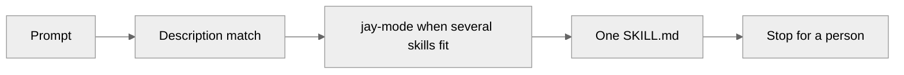

# How it works

The agent does not load the whole pack. It matches your request, opens one playbook, and loads the principles that apply.

<ol class="jstack-steps">
<li><strong>Prompt</strong>You name the place and the job.</li>
<li><strong>Match</strong>The skill description is the trigger.</li>
<li><strong>One file</strong><code>jay-mode</code> picks a row when several skills fit.</li>
<li><strong>Stop</strong>A person approves. The pipeline applies.</li>
</ol>

## A skill is a folder

`skills/<name>/SKILL.md` has two fields the agent uses.

- `name` is the folder name.
- `description` is the trigger. It says when to load the file, and the outcome.

`AGENTS.md` is the index. Each line names the skill and when to open that file.

Loaded means the agent reads that `SKILL.md` before it edits. A summary from memory is not loaded.

## Two kinds of skill

<strong>Principle</strong>A <code>principle-*</code> file is a short rule used across areas. Every request also loads <code>principle-stop-at-approval</code>.

<strong>Playbook</strong>Every other file is one job: Use when, Steps, Safety checks, Rollback, and Done when.

`jay-mode` is the router. Take the first matching row. That row names the one skill to load.

## What the agent may finish

The agent prepares the diff, the saved plan, or the ticket. It does not apply, merge, or grant itself access.

## Where each tool reads

| Tool | What it reads |
| --- | --- |
| Cursor | The plugin manifest `.cursor-plugin/plugin.json` |
| GitHub Copilot | `gh skill install`, or a copy made by `scripts/sync` |
| Claude Code, Codex, and others | `AGENTS.md` plus `.agents/skills` or `.claude/skills` |

## Names

<code>terraform-</code> <code>azure-</code> <code>aws-</code> <code>pipelines-</code> <code>github-</code> <code>azuredevops-</code> <code>servicenow-</code> <code>k8s-</code> <code>gitops-</code> <code>policy-</code> <code>ops-</code> <code>principle-</code>

`jay-mode` and `setup-jstack` have no prefix.

## The same path, drawn

