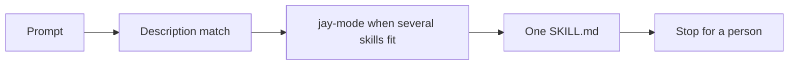

# How it works

An agent does not load the whole pack for one edit. It matches the request, opens one playbook, and loads the principles that apply.

## A skill is a folder

`skills/<name>/SKILL.md` starts with `name` and `description`. `name` is the folder name. `description` is what the agent matches on, so it says the trigger and the outcome.

`AGENTS.md` is the index. Each line names the skill and when to load that file.

## Principles and playbooks

A `principle-*` skill is a short rule used across areas. Every other skill is a playbook with Use when, Steps, Safety checks, Rollback, and Done when.

`jay-mode` is the router. When more than one skill could fit, take the first matching row. That row names the one skill to load. Every classification also loads `principle-stop-at-approval`.

## What the agent is allowed to finish

The agent prepares the diff, the saved plan, or the ticket. A person approves. The pipeline applies. The agent does not apply, merge, or grant itself access.

## Where each tool reads

| Tool | What it reads |
| --- | --- |
| Cursor | `.cursor-plugin/plugin.json` points `skills` at `./skills/` and `agents` at `./agents/` |
| GitHub Copilot | A skills directory from `gh skill install`, or a copy made by `scripts/sync` |
| Claude Code, Codex, and others | `AGENTS.md` plus `.agents/skills` or `.claude/skills` |

Area prefixes are `terraform-`, `azure-`, `aws-`, `pipelines-`, `github-`, `azuredevops-`, `servicenow-`, `k8s-`, `gitops-`, `policy-`, `ops-`, and `principle-`. `jay-mode` and `setup-jstack` have no prefix.

Loaded means the agent reads that `SKILL.md` before it edits. A summary from memory is not loaded.
