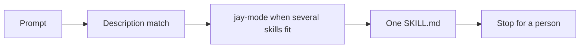

# How it works

An agent does not load the whole pack for one edit. It matches the request, opens one playbook, and loads the principles that apply.

## A skill is a folder

`skills/<name>/SKILL.md` has two fields the agent uses:

- `name` is the folder name.
- `description` is the trigger. It says when to load the file, and what the outcome is.

`AGENTS.md` is the index. Each line names the skill and when to open that file.

Loaded means the agent reads that `SKILL.md` before it edits. A summary from memory is not loaded.

## Principles and playbooks

- A `principle-*` skill is a short rule used across areas.
- Every other skill is a playbook: Use when, Steps, Safety checks, Rollback, and Done when.
- `jay-mode` is the router. When more than one skill could fit, take the first matching row. That row names the one skill to load.
- Every classification also loads `principle-stop-at-approval`.

## What the agent may finish

The agent prepares the diff, the saved plan, or the ticket.

A person approves. The pipeline applies. The agent does not apply, merge, or grant itself access.

## Where each tool reads

| Tool | What it reads |
| --- | --- |
| Cursor | The plugin manifest `.cursor-plugin/plugin.json` |
| GitHub Copilot | `gh skill install`, or a copy made by `scripts/sync` |
| Claude Code, Codex, and others | `AGENTS.md` plus `.agents/skills` or `.claude/skills` |

## Names

<code>terraform-</code> <code>azure-</code> <code>aws-</code> <code>pipelines-</code> <code>github-</code> <code>azuredevops-</code> <code>servicenow-</code> <code>k8s-</code> <code>gitops-</code> <code>policy-</code> <code>ops-</code> <code>principle-</code>

`jay-mode` and `setup-jstack` have no prefix.
